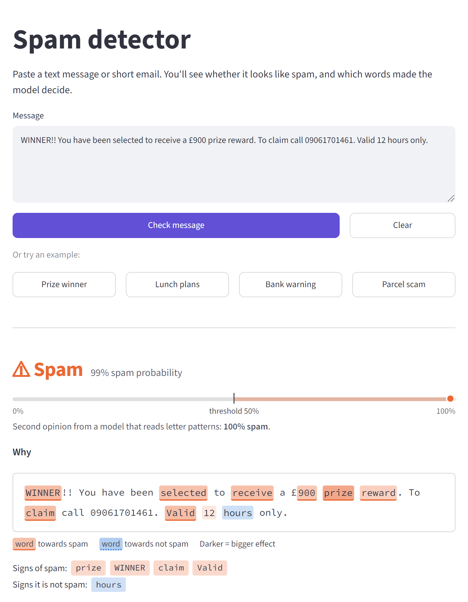
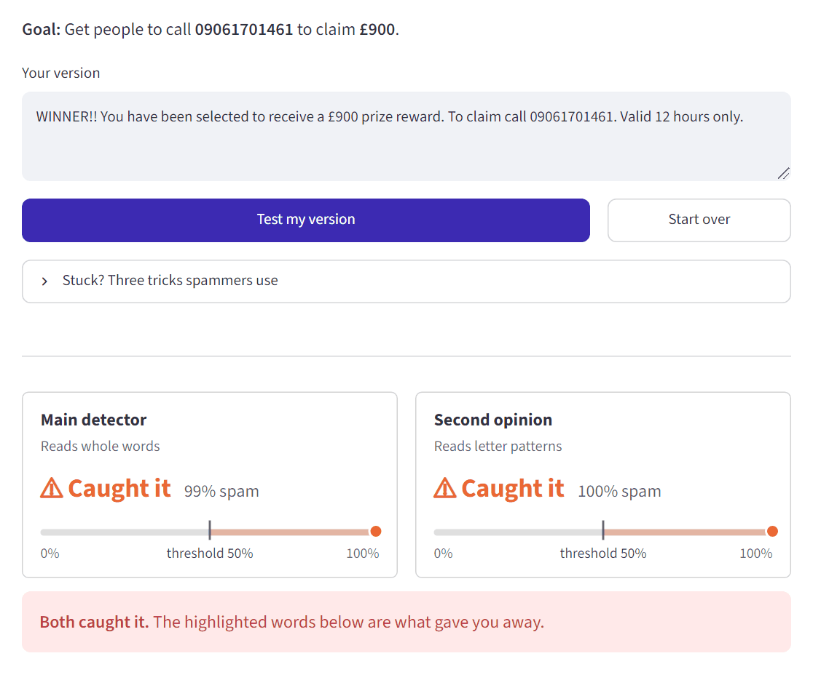
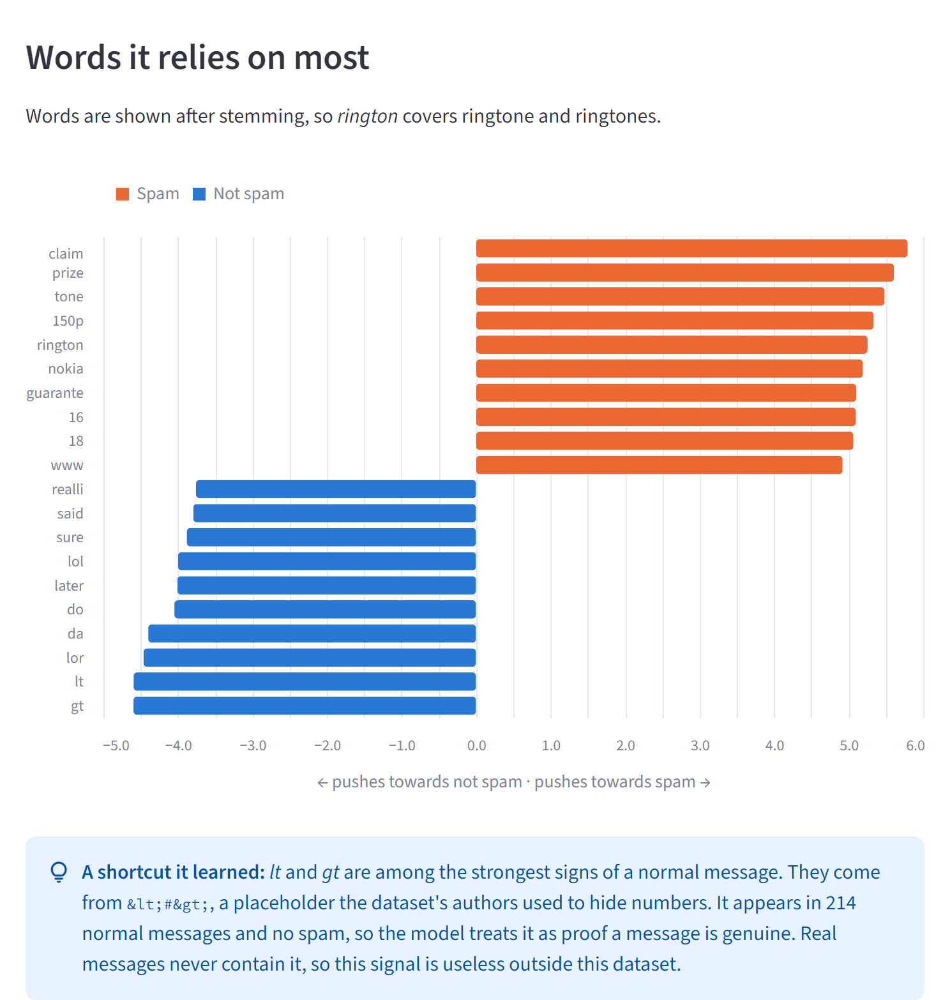
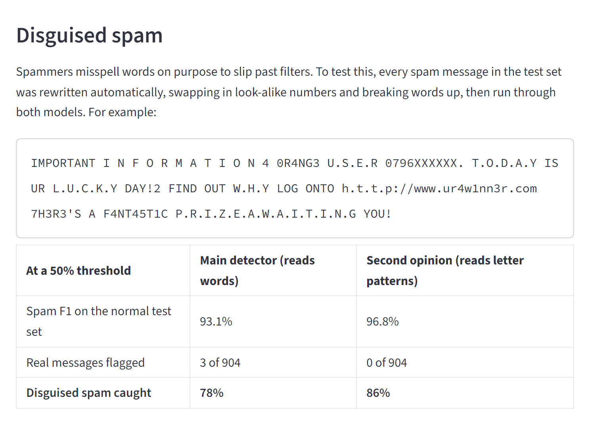
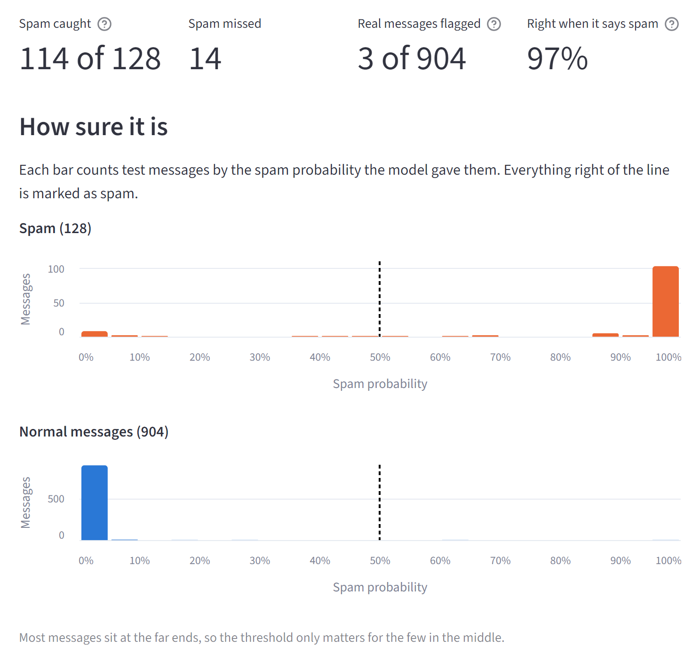
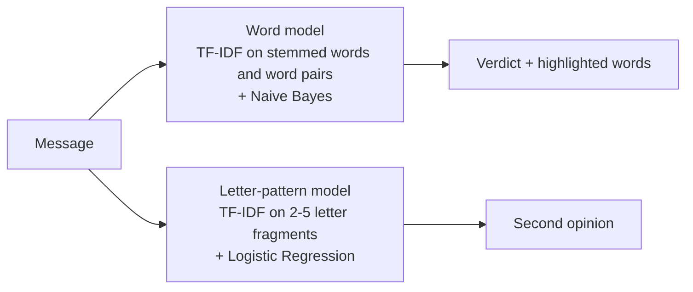

# Spam Detector That Shows Its Reasoning

A spam filter that highlights the words behind every verdict, is upfront about its mistakes, and challenges you to sneak spam past it.

[](https://email-spam-detector-ml-project.streamlit.app/)


**[Try the live app](https://email-spam-detector-ml-project.streamlit.app/)** · **[Read the case study](CASE_STUDY.md)**

<picture>
  <source media="(prefers-color-scheme: dark)" srcset="docs/images/check-dark.png">
  
</picture>

## What makes it different

Most spam detectors stop at "TF-IDF + Naive Bayes, 98% accuracy". This one started there too, as an internship project, and was then audited and rebuilt.

- **It explains every verdict.** Each word is highlighted by how much it pushed the message towards spam (orange) or not spam (blue).
- **It reports honest numbers.** The original "98% accuracy" was measured with test messages leaking into training, and it hid that 1 in 9 spam messages got through. The rebuilt app reports what matters: how much spam is caught and how often real messages get flagged.
- **It shows its own mistakes.** A report page lists every test message the model gets wrong, and points out a shortcut it learned from quirks in the dataset.
- **You can try to beat it.** The *Try to fool it* page challenges you to rewrite real spam so it slips through, while a second model that reads letter patterns tries to catch you.

The [case study](CASE_STUDY.md) tells the full story: a saved model that had never been trained, duplicate messages leaking between training and test data, a feedback button that never saved anything, and what fixing them revealed.

## Try to fool it

Rewrite a scam message so the detector misses it, but keep the phone number, or it doesn't count. Two models judge every attempt:



Swapping in look-alike digits ("pr1ze") gets past the word model, because "pr1ze" isn't a word it knows. The letter-pattern model still sees fragments of "prize" and catches it. Rewording the scam to sound like a friend fools both, because neither model knows what a message is *for*.

## What it found

**The model learned a shortcut.** Two of its strongest signs that a message is *not* spam are the fragments *lt* and *gt*. They come from `&lt;#&gt;`, a placeholder the dataset's creators used to hide numbers, which appears in 214 normal messages and in no spam. It is useless outside this dataset, and only inspecting the model's weights revealed it.



**Disguised spelling beats a word model.** Every test spam message was rewritten automatically ("I N F O R M A T I O N", "P.R.I.Z.E") and re-scored. The word model's catch rate fell from 89% to 78%, while the letter-pattern model still caught 86%.



## Results

On 1,032 messages the models never saw during training, at a 50% threshold:

| | Word model (main verdict) | Letter-pattern model (second opinion) |
|---|---|---|
| Spam caught (recall) | 89.1% (114 of 128) | 93.8% (120 of 128) |
| Right when it says spam (precision) | 97.4% | 100% |
| Spam F1 | 93.1% | 96.8% |
| Real messages wrongly flagged | 3 of 904 | 0 of 904 |
| Accuracy | 98.4% | 99.2% |
| Disguised spam caught | 78% | 86% |

The letter-pattern model is more accurate, so why isn't it the main detector? Its reasons are letter fragments like "ze!", which explain nothing to a person. The word model gives the verdict you can read, and the letter-pattern model is shown alongside as a second opinion.

Accuracy is listed last on purpose: 87% of the messages are not spam, so a model that never flags anything already scores 87%. The app's report page shows how the numbers change as you move the threshold:



## How it works



- **Data:** the [UCI SMS Spam Collection](https://archive.ics.uci.edu/dataset/228/sms+spam+collection), with 414 duplicate messages removed before splitting, so no message appears in both training and test data.
- **Model choice:** each model's classifier (Naive Bayes or Logistic Regression) is picked by 5-fold cross-validation on the training data only. The test set is used once, for the final numbers.
- **Probabilities:** both models are calibrated, so "70% spam" means roughly that.
- **Explanations:** a word's highlight is its TF-IDF weight times how strongly the model links it to spam.
- **Feedback and retraining:** users can mark a verdict right or wrong. `update_model.py` retrains on that feedback and only replaces the live model if it scores at least as well on the same test set.

## Known limits

- **It learned from UK text messages from around 2011.** Modern scams, like parcel-delivery texts with short links, score under 1%. Despite the repository's name, it hasn't been tested on email.
- **It reads words, not intent.** A scam reworded to sound friendly gets through both models.
- **Feedback on the live app doesn't last.** Streamlit Cloud wipes its files when the app restarts, so feedback is only kept when you run the app yourself.

## Run it yourself

```bash
git clone https://github.com/Getrudetrudy01/Email-spam-detector-using-machine-learning-model.git
cd Email-spam-detector-using-machine-learning-model
python -m venv .venv
.venv\Scripts\activate          # macOS/Linux: source .venv/bin/activate
pip install -r requirements.txt
streamlit run streamlit_app.py
```

Trained models are included. To retrain them and print the results above, run `python train_model.py`. To run the 23 tests or the exploration notebook, install `requirements-dev.txt` and run `pytest`.

Versions are pinned in `requirements.txt` because a saved scikit-learn model is only guaranteed to load with the version that trained it. If you upgrade scikit-learn, retrain.

**Retraining with feedback:** feedback is saved to `feedback_data.csv`, which is kept out of git because it contains what people typed. Read it before running `python update_model.py`, since anyone can submit a wrong label on purpose. Use `--force` to replace the model even if it scores worse; the previous model is kept in `models/previous/`.

## Project structure

| File | Purpose |
|---|---|
| `streamlit_app.py` | App entry point and navigation |
| `views/check_message.py` | Check a message and see why |
| `views/fool_it.py` | The *Try to fool it* challenge |
| `views/model_report.py` | Test results, top words, disguised spam and every mistake |
| `app_ui.py` | Shared app pieces: model loading, threshold slider, highlighting, styles |
| `spam_core.py` | Data loading, preprocessing, models, metrics, disguising and feedback |
| `train_model.py` | Trains both models and saves their metrics |
| `update_model.py` | Retrains the word model with feedback, only replacing it if it isn't worse |
| `models/` | Both trained models and `metrics.json` |
| `spam.ipynb` | Original exploration, comparing 11 classifiers |
| `tests/` | Tests for the core code and each app page |
| `CASE_STUDY.md` | The audit, the fixes and the findings |

## Credits

Dataset: T. A. Almeida, J. M. Gómez Hidalgo and A. Yamakami, *Contributions to the Study of SMS Spam Filtering: New Collection and Results*, ACM DocEng 2011, via the [UCI Machine Learning Repository](https://archive.ics.uci.edu/dataset/228/sms+spam+collection).

Built by [Getrude Makumator](https://github.com/Getrudetrudy01).
